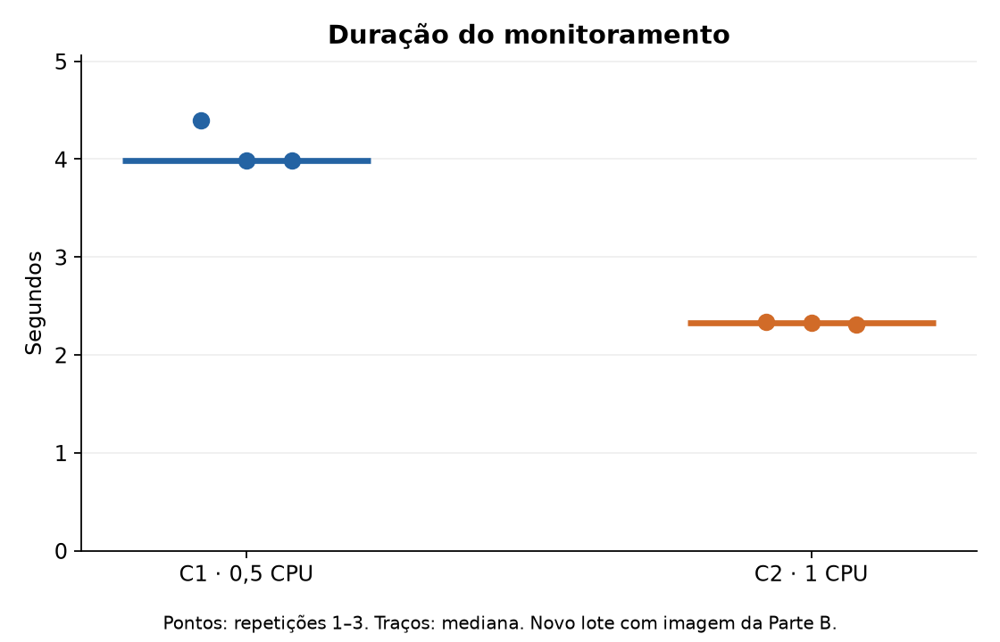
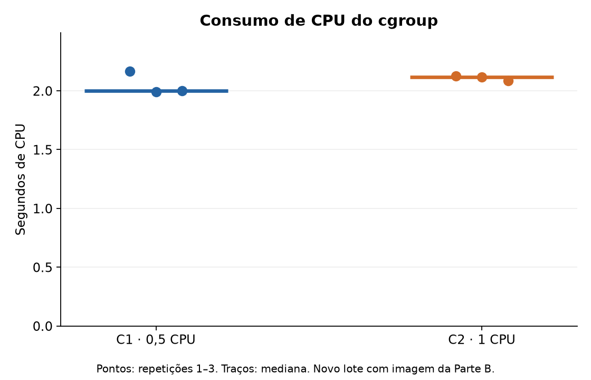
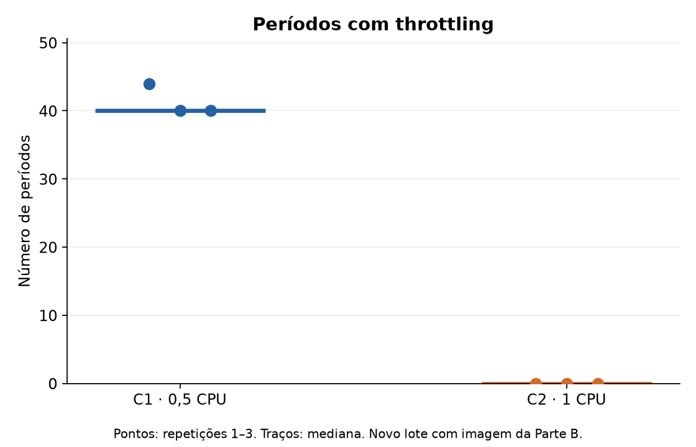

# Parte C — Execuções com referência na Parte B (Fagner)

Responsável pelas execuções: Vênisson Cardoso dos Santos. Atualização em 10/11/2026.

## Protocolo e substituição

As seis repetições foram reexecutadas por Vênisson Cardoso dos Santos em 10/11/2026, no lote 20261110T144547Z_2382, na ordem C1/R1, C2/R1, C1/R2, C2/R2, C1/R3, C2/R3. Cada carga realizou 20.000.000 de iterações; a consolidação usa scripts/verifica_limites.py. Este lote substitui os resultados anteriores da Parte C na análise principal; os lotes de VirtualBox e o primeiro lote WSL2 foram arquivados como substituídos.

Ambiente medido: Docker Desktop 4.99.0, Engine 29.9.3, Ubuntu 24.04.5 LTS/WSL2, kernel 6.18.54.1-microsoft-standard-WSL2, cgroups v2/cgroupfs, 16 CPUs lógicas e 3.734 GiB no Engine.

A referência é a metodologia da Parte B do relatório compartilhado e o log evidencia_ns_mount_20261109_203438.log. A padronização é parcial: mesma imagem por digest, arquitetura linux/amd64, Docker Desktop/WSL2, cgroups v2 e driver cgroupfs. Fagner registrou Desktop 4.87.0, Engine 29.7.2, Ubuntu 26.04, kernel 6.18.33.2 e 12 CPUs. As versões e o hardware locais não foram alterados para imitar esse host; sua RAM não foi registrada na referência. Não se afirma identidade de ambientes nem normalização ao ambiente não publicado do Enzo.

Os quatro contêineres clinicaescola permaneceram ativos antes e depois das medições; outros aplicativos do usuário não foram encerrados. Não é um ensaio em host ocioso. Os limites da Parte C foram mantidos: 0,5/1 CPU, 256 MiB, sem swap adicional, 64 PIDs, rede desativada e três repetições por condição. A carga e o coletor mantiveram seus bytes; o executor mudou somente o digest e a remoção de sudo.

Imagem: `python@sha256:5e2bdb1b0d542d5039cffb8181c65930093949194a65c365dfb1b0fe13a4fa5b`. Python 3.12.16 no contêiner, confirmado no diagnóstico. O digest de índice da referência seleciona uma imagem linux/amd64; a inspeção salva registra também o ID concreto. O coletor original consulta `cpu.max`, `memory.max` e `pids.max`; um diagnóstico separado confirma `memory.swap.max=0`.

## Resultados do novo lote

O trabalho foi idêntico: 20.000.000 de iterações, checksum 4.864.000, status de sucesso, código zero, sem timeout ou stderr nas seis execuções. A mediana de CPU do cgroup foi 2,001 s em C1 e 2,115 s em C2. Essa CPU pertence ao conjunto coletor mais carga.

A mediana do wall interno da carga foi 3,821 s em C1 e 2,137 s em C2; a mediana de monitoramento foi 3,986 s e 2,324 s, respectivamente (razão C1/C2 de 1,715). A comparação é descritiva, com apenas três repetições por condição.

| Execução | CPU cgroup (s) | Janela nominal (s) | Períodos | Throttled | % | Throttling (s) |
| --- | --- | --- | --- | --- | --- | --- |
| C1_R1 | 2,168 | 4,40 | 44 | 44 | 100,0% | 1,849 |
| C1_R2 | 1,990 | 4,00 | 40 | 40 | 100,0% | 1,691 |
| C1_R3 | 2,001 | 4,00 | 40 | 40 | 100,0% | 1,724 |
| C2_R1 | 2,125 | 2,40 | 24 | 0 | 0,0% | 0,000 |
| C2_R2 | 2,115 | 2,30 | 23 | 0 | 0,0% | 0,000 |
| C2_R3 | 2,084 | 2,30 | 23 | 0 | 0,0% | 0,000 |

O novo lote apresentou throttling em C1 (100,0% a 100,0%) e em C2 (0,0% a 0,0%). Esses percentuais descrevem os períodos contabilizados neste lote; não devem ser interpretados como percentuais do tempo de execução.







## Memória e amostragem

| Execução | RSS do processo | memory.current (fim) | memory.peak | Teto | % do teto |
| --- | --- | --- | --- | --- | --- |
| C1_R1 | 15,84 MiB | 15,61 MiB | 25,03 MiB | 256 MiB | 9,8% |
| C1_R2 | 15,69 MiB | 12,61 MiB | 22,37 MiB | 256 MiB | 8,7% |
| C1_R3 | 15,66 MiB | 13,17 MiB | 22,61 MiB | 256 MiB | 8,8% |
| C2_R1 | 15,81 MiB | 12,61 MiB | 22,01 MiB | 256 MiB | 8,6% |
| C2_R2 | 15,76 MiB | 15,72 MiB | 25,38 MiB | 256 MiB | 9,9% |
| C2_R3 | 15,75 MiB | 12,89 MiB | 22,28 MiB | 256 MiB | 8,7% |

O maior memory.peak foi 25,38 MiB (9,9% do teto). Os valores estão abaixo de 256 MiB, mas não demonstram comportamento sob pressão de memória ou OOM. pids.max=64 foi confirmado, sem teste de saturação.

| Execução | % períodos throttled | Amostras | Monitoramento/amostras | Razão para 50 ms |
| --- | --- | --- | --- | --- |
| C1_R1 | 100,0% | 82 | 0,054 s | 1,1× |
| C1_R2 | 100,0% | 76 | 0,052 s | 1,0× |
| C1_R3 | 100,0% | 75 | 0,053 s | 1,1× |
| C2_R1 | 0,0% | 45 | 0,052 s | 1,0× |
| C2_R2 | 0,0% | 44 | 0,053 s | 1,1× |
| C2_R3 | 0,0% | 44 | 0,052 s | 1,0× |

A razão monitoramento/amostras variou de 0,052 s a 0,054 s. É um indicador aproximado de densidade de amostragem: não há timestamps individuais para medir intervalos reais ou jitter. Não se deve atribuir causalmente qualquer atraso ao throttling só por essa razão.

## Questão 4 e limites de interpretação

A quota foi confirmada pelas leituras `50000 100000` e `100000 100000` nos seis JSON, correspondendo a 0,5 e 1 CPU por período de 100 ms. `memory.max=268435456` e `pids.max=64` também conferiram. O novo lote apresentou throttling em C1 (100,0% a 100,0%) e em C2 (0,0% a 0,0%). Esses percentuais descrevem os períodos contabilizados neste lote; não devem ser interpretados como percentuais do tempo de execução.

O coletor continua no mesmo cgroup da carga, lendo RSS nominalmente a cada 50 ms. Portanto, compartilha a quota, acrescenta custo de CPU e pode sofrer atrasos de escalonamento. memory.peak, memory.current e RSS têm escopos distintos. O pico do cgroup não permite localizar o instante do máximo nem atribuí-lo a um único processo.

Os lotes antigos com discrepâncias entre relógios foram retirados da análise principal. Não se reutilizam aqui suas hipóteses de causa, valores de soft lockup ou conclusões de degradação. O novo lote tem seus próprios registros; a troca de imagem, sistema, versão e cargas concorrentes impede atribuir diferenças entre lotes exclusivamente à virtualização.

Uma instrumentação futura pode observar o cgroup por fora e registrar timestamps por amostra; isso exigiria outro protocolo e novo lote. Nesta execução, o coletor original foi mantido para preservar a definição da carga e a comparabilidade entre C1 e C2. Os JSON brutos e os hashes ficam em evidencias/parte_c_venisson; as tabelas desta seção usam apenas o novo lote.

## Fontes e trilha de evidências

- Referência documental: [Metodologia da Parte B no relatório compartilhado](https://docs.google.com/document/d/1MaZRUQI5yHYMexa8F3mkOm6dmpE4qBVHiCkkYb2SuyQ/edit?tab=t.0). O Google Docs foi preservado; os resultados deste novo lote estão neste arquivo.
- Referência do GitHub: [relatório de Fagner](parte_b_relatorio_fagner.md) e [log da Parte B](../evidencias/evidencia_ns_mount_20261109_203438.log), disponíveis no commit base `8f47ee56cc49394418865cb2ffb286e807c6415c`.
- [JSON brutos e manifesto](../evidencias/parte_c_venisson/resultados/20261110T144547Z_2382/): seis execuções, stderr, digest e iterações.
- [Log da execução](../evidencias/parte_c_venisson/execucao.log): ordem e códigos de saída.
- [Ambiente](../evidencias/parte_c_venisson/ambiente/): Engine, imagem, Ubuntu, kernel, serviços concorrentes, diagnóstico e datas UTC.
- [CSV consolidado](../evidencias/parte_c_venisson/resultados_consolidados.csv), [medianas](../evidencias/parte_c_venisson/resumo_mediana.csv) e [validação](../evidencias/parte_c_venisson/validacao_execucoes.csv): gerados exclusivamente dos seis novos JSON.
- [SHA256SUMS](../evidencias/parte_c_venisson/SHA256SUMS.txt): hashes relativos à raiz do repositório, cobrindo evidências, carga, coletor, executor e este relatório. O checksum da carga foi conferido independentemente pela soma dos quadrados módulo 1.000.000.007.

Os JSON, gráficos e o pacote compactado do lote anterior foram retirados da pasta de evidências vigente. O histórico de commits mantém o registro da substituição. O relatório e a tabela do Filipe não foram modificados nesta atualização e ainda descrevem o lote anterior; não devem ser usados como análise deste novo lote.

## Reprodução

No Ubuntu integrado ao Docker Desktop, a partir da raiz do repositório:

```bash
bash scripts/parte_c_venisson/run_experimentos.sh
python3 scripts/verifica_limites.py evidencias/parte_c_venisson/resultados/20261110T144547Z_2382 --csv consolidacao_verificacao.csv
```

O executor cria uma pasta própria para cada novo lote em `scripts/parte_c_venisson/resultados/`. O caminho acima aponta para o lote publicado; ao repetir a execução, use o diretório novo mostrado pelo executor. Esta atualização é destinada à branch `feature/parte-c-venisson` e não altera a branch principal.
