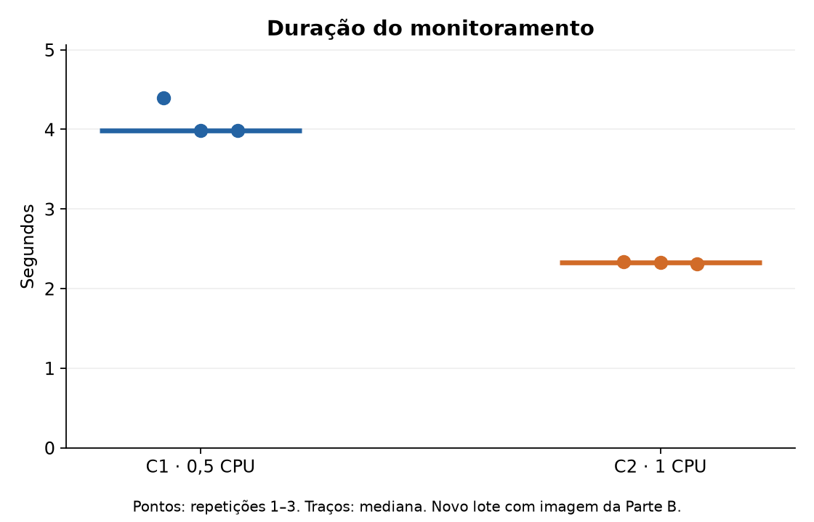
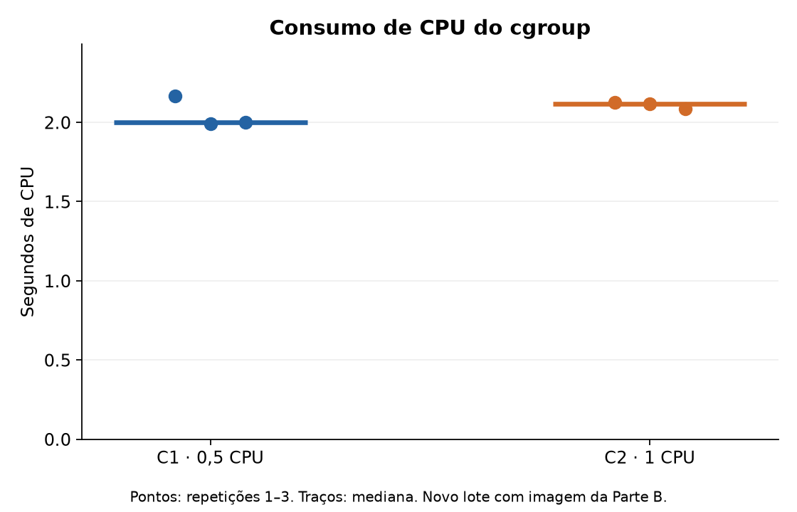
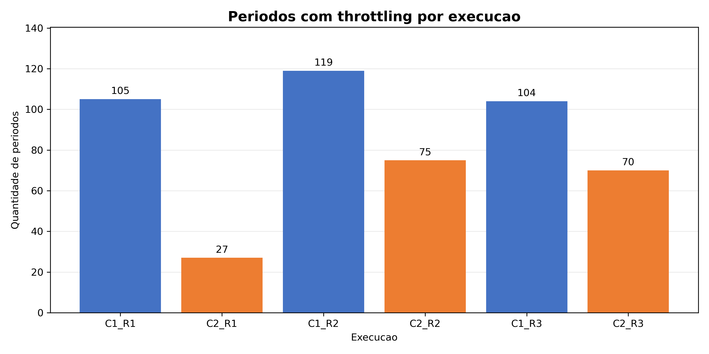

# Atividade 3 — Sistemas Operacionais
## Relatório Final Consolidado

**Universidade Federal de Sergipe — UFS**  
**Período:** 2026.2  
**Consolidação editorial:** Katyane dos Santos

## 1. Introdução

Este relatório apresenta os resultados da Atividade 3 de Sistemas Operacionais, dedicada à investigação de contêineres Linux e dos mecanismos utilizados pelo kernel para isolamento, contabilização e controle de recursos.

A atividade contempla quatro eixos: identificação do ambiente de execução, análise de namespaces, experimentos com cgroups v2 e verificação de montagem somente leitura.

Os resultados foram consolidados a partir dos relatórios, scripts e evidências produzidos pelos integrantes da equipe. As diferenças entre os ambientes utilizados nas coletas são identificadas explicitamente, evitando apresentar experimentos independentes como uma única execução.

## 2. Parte A — Ambiente e diagrama de camadas

**Responsável:** Enzo Costa.

A coleta da Parte A foi realizada em 10/11/2026, em um computador com Windows 10 Home Single Language, utilizando Ubuntu 24.04.1 LTS no WSL2 e Docker Desktop.

| Componente | Ambiente observado |
|---|---|
| Sistema operacional do host | Windows 10 Home, build 19045 |
| Distribuição Linux | Ubuntu 24.04.1 LTS |
| Kernel Linux | `6.18.58.1-microsoft-standard-WSL2` |
| Docker Desktop | 4.95.0 |
| Docker Engine | 29.8.2 |
| CPUs disponíveis ao Docker | 8 |
| Memória disponível ao Docker | 3,754 GiB |
| Cgroups | v2, driver `cgroupfs` |
| Imagem | `python:3.12-slim` |

A imagem utilizada foi identificada pelo digest:

`python@sha256:5e2bdb1b0d542d5039cffb8181c65930093949194a65c365dfb1b0fe13a4fa5b`

### Questão 1 — Kernel compartilhado e virtualização

Os contêineres Linux compartilham o kernel Linux disponibilizado pelo backend WSL2 do Docker Desktop. Eles não executam um kernel próprio para cada contêiner nem utilizam diretamente o kernel do Windows.

Existe uma camada intermediária de virtualização leve, gerenciada pelo WSL2, entre o host Windows e os ambientes Linux.

O diagrama de camadas completo está documentado em `relatorio/parte_a_ambiente_enzo.md`.

## 3. Parte B — Namespaces

**Responsável:** Fagner Junqueira.

Foram criados dois contêineres independentes, identificados como `so_av3_fagner_cntA` e `so_av3_fagner_cntB`, utilizando a mesma imagem fixada por digest.

A coleta registrou os identificadores dos namespaces de PID, montagem e rede associados ao processo PID 1 de cada contêiner.

| Namespace | Contêiner A | Contêiner B |
|---|---|---|
| PID | `pid:[4026532869]` | `pid:[4026532945]` |
| Mount | `mnt:[4026532401]` | `mnt:[4026532942]` |
| Network | `net:[4026532871]` | `net:[4026532947]` |

### Questão 2 — Evidências de isolamento

Os identificadores distintos demonstram que os processos pertencem a namespaces diferentes.

No namespace de PID, ambos os contêineres podem apresentar um processo identificado internamente como PID 1, embora esses processos tenham identificadores diferentes no host do daemon Docker.

Na coleta, os PIDs observados no host foram 6633 e 6679.

A separação dos namespaces de montagem e rede indica estruturas de controle distintas no kernel. Entretanto, essa diferença não comprova, isoladamente, ausência de conectividade entre contêineres, bloqueio de escrita ou proteção contra fuga do contêiner.

### Questão 3 — Namespace, cgroup, identidade e política de acesso

**Namespace:** mecanismo que determina a visão dos recursos disponibilizada a um processo. No experimento, cada contêiner possui namespaces próprios de PID, montagem e rede.

**Cgroup:** mecanismo utilizado para contabilizar e limitar o consumo de recursos. Na Parte C, foram configuradas quotas de CPU e limites de memória e PIDs.

**Identidade:** conjunto de credenciais associado ao processo, incluindo UID, GID e capacidades.

**Política de acesso:** regras que determinam quais operações são permitidas. Na Parte D, foi utilizada uma montagem somente leitura para impedir alterações em um diretório compartilhado.

A Parte B verificou diretamente os namespaces; os demais mecanismos pertencem às etapas específicas do laboratório.

## 4. Parte C — Cgroups e experimentos

**Execução do lote atualizado:** Vênisson Cardoso dos Santos.  
**Análise complementar dos limites:** baseada no relatório de Filipe de Carvalho Godoy.  
**Consolidação editorial:** Katyane dos Santos.

A análise principal utiliza exclusivamente o lote experimental `20261110T144547Z_2382`, executado em 10/11/2026.

Foram realizadas seis execuções, com três repetições de cada condição, alternadas na sequência C1_R1, C2_R1, C1_R2, C2_R2, C1_R3 e C2_R3.

Cada execução realizou 20 milhões de iterações e produziu o checksum 4.864.000.

### 4.1 Configuração dos limites

| Recurso | C1 | C2 |
|---|---|---|
| `cpu.max` | `50000 100000` | `100000 100000` |
| Quota de CPU | 0,5 CPU | 1 CPU |
| `memory.max` | 256 MiB | 256 MiB |
| `pids.max` | 64 | 64 |
| Swap adicional | Desabilitado | Desabilitado |
| Rede | Desabilitada | Desabilitada |

### 4.2 Resultados das seis execuções

| Execução | Tempo da carga (s) | CPU do cgroup (s) | Throttling (%) |
|---|---:|---:|---:|
| C1_R1 | 3,895 | 2,168 | 100 |
| C1_R2 | 3,812 | 1,990 | 100 |
| C1_R3 | 3,821 | 2,001 | 100 |
| C2_R1 | 2,137 | 2,125 | 0 |
| C2_R2 | 2,166 | 2,115 | 0 |
| C2_R3 | 2,081 | 2,084 | 0 |

Todas as execuções terminaram com código de saída zero, sem timeout e sem erros registrados no stderr.

### Questão 4 — Confirmação dos limites e interpretação das métricas

A quota de CPU foi confirmada diretamente pela leitura de `cpu.max`.

Na condição C1, o kernel registrou throttling em todos os períodos contabilizados. Na condição C2, não foram registrados períodos com throttling.

As medianas de consumo de CPU do cgroup foram aproximadamente 2,001 s em C1 e 2,115 s em C2.

Os contadores incluem o consumo da carga e do coletor, que executaram no mesmo cgroup. Portanto, esses valores não representam exclusivamente a CPU utilizada pelo programa experimental.

O limite de memória foi de 256 MiB em ambas as condições. O maior valor de `memory.peak` observado foi 25,38 MiB, aproximadamente 9,9% do limite.

As métricas RSS, `memory.current` e `memory.peak` representam medições de escopos diferentes e não devem ser consideradas equivalentes.

O experimento confirmou a configuração dos limites, mas não realizou testes de saturação de memória ou PIDs.

### Questão 5 — Comparação entre as condições

| Métrica | C1 | C2 |
|---|---:|---:|
| Mediana do tempo da carga | 3,821 s | 2,137 s |
| Mediana do monitoramento | 3,986 s | 2,324 s |
| Mediana da CPU do cgroup | 2,001 s | 2,115 s |
| Períodos com throttling | 100% | 0% |

A mediana do tempo da carga foi aproximadamente 44% menor em C2.

Como o trabalho realizado e o checksum permaneceram constantes, a diferença observada está associada às condições de execução, especialmente à quota de CPU disponível.

Essa comparação é descritiva, baseada em três repetições por condição, e não estabelece desempenho esperado para outros computadores ou cargas.

Os gráficos originais estão disponíveis em `evidencias/parte_c_venisson/graficos/`.

**Autoria da análise da Questão 5:** pendente de confirmação da contribuição específica de Rauany.

## 5. Parte D — Montagem somente leitura e menor privilégio

**Responsável pela Parte D:** Giulian Fábio Bastos Amorim Lima.  
**Execução da coleta compartilhada:** Fagner Junqueira, conforme registro do script e do log.

O experimento utilizou um diretório sintético compartilhado com o contêiner B por meio de uma montagem configurada como somente leitura:

`-v "$PWD/dados_demo:/dados:ro"`

### Resultados observados

A leitura do arquivo `/dados/texto.txt` foi permitida, retornando o conteúdo `Documento sintetico`.

A tentativa de criar `/dados/novo.txt` foi negada pelo sistema de arquivos, com a mensagem:

`touch: cannot touch '/dados/novo.txt': Read-only file system`

Esses resultados demonstram que a montagem somente leitura impediu a operação de escrita testada.

### Gráficos dos resultados experimentais

**Figura 1 — Duração do monitoramento**

**Figura 2 — Consumo de CPU**

**Figura 3 — Throttling**

### Questão 6 — Controle de acesso e menor privilégio

A opção `:ro` restringe operações de escrita no volume montado, oferecendo uma proteção específica à integridade dos arquivos compartilhados.

Entretanto, o script analisado não configura explicitamente execução com usuário não root, remoção de capacidades ou a opção `no-new-privileges`.

Portanto, a evidência comprova a restrição de escrita da montagem, mas não permite afirmar que todas as medidas de menor privilégio foram aplicadas.

As evidências estão registradas em `evidencias/evidencia_ns_mount_20261109_203438.log` e nas imagens da Parte D.

## 6. Limitações dos experimentos

Os resultados das Partes A, B/D e C foram obtidos em ambientes diferentes.

| Parte | Kernel Linux | Docker Engine |
|---|---|---|
| A — Enzo | 6.18.58.1 | 29.8.2 |
| B/D — Fagner e Giulian | 6.18.33.2 | 29.7.2 |
| C — Vênisson | 6.18.54.1 | 29.9.3 |

Apesar de utilizarem a mesma imagem por digest e tecnologias semelhantes, essas coletas não constituem uma execução em ambiente único.

A Parte C também foi executada em um ambiente com outros contêineres ativos, e o coletor compartilhou os limites de CPU com a carga.

As conclusões devem ser interpretadas dentro dessas condições experimentais.

## 7. Conclusão

A atividade permitiu observar diferentes mecanismos de isolamento e controle utilizados pelo kernel Linux na execução de contêineres.

A Parte A identificou a arquitetura Docker Desktop/WSL2 e o compartilhamento do kernel Linux.

A Parte B demonstrou a existência de namespaces distintos de PID, montagem e rede.

A Parte C confirmou limites de CPU, memória e PIDs, além de evidenciar a ocorrência de throttling na condição de menor quota de CPU e a redução do tempo de execução na condição de maior quota.

A Parte D demonstrou a efetividade da montagem somente leitura na operação de escrita testada.

Os resultados evidenciam que namespaces, cgroups, identidade e políticas de acesso desempenham funções diferentes e complementares.

As diferenças de ambiente e as verificações de segurança não realizadas delimitam o alcance das conclusões.

## 8. Referências e rastreabilidade

**Documentos internos:**

- `relatorio/parte_a_ambiente_enzo.md`
- `relatorio/parte_b_relatorio_fagner.md`
- `relatorio/parte_c_experimentos_venisson.md`
- `relatorio/parte_c_limites_filipe.md`
- `relatorio/parte_c_limites_atualizacao_20261110.md`

**Evidências e scripts:**

- `evidencias/parte_a_ambiente_enzo.md`
- `evidencias/evidencia_ns_mount_20261109_203438.log`
- `evidencias/parte_c_venisson/`
- `scripts/evidencia_ns_mount.sh`
- `scripts/parte_c_venisson/`

**Referências técnicas:**

- Linux man-pages. *namespaces(7)*. https://man7.org/linux/man-pages/man7/namespaces.7.html
- Linux Kernel Documentation. *Control Group v2*. https://docs.kernel.org/admin-guide/cgroup-v2.html
- Docker Documentation. *Resource constraints*. https://docs.docker.com/engine/containers/resource_constraints/

**Pendências de validação antes da entrega:** confirmar a contribuição de Rauany, verificar a documentação complementar de menor privilégio de Giulian, revisar a exigência de ambiente único e conferir os dados finais de apresentação e vídeo.

## Complemento da integracao

Autoria experimental da Parte C: Venisson Cardoso dos Santos e Katyane dos Santos; execucao local de Venisson. Vazao mediana C1/C2: 5.234.746 / 9.360.250 iteracoes/s; amplitudes do wall: 0,083601 / 0,084754 s. Sao tres repeticoes por condicao, exclusivamente WSL2.

Video: https://drive.google.com/file/d/1OREg4M7iMNTn85Jl9wyk5ezy-Nb6A88Z/view?usp=drive_link

Apresentacao: https://canva.link/moqubp5sz74mp3v

As pendencias de contribuicao de Rauany, comprovacao completa de menor privilegio, participacao no video e revisao dos slides permanecem humanas. O enunciado nao exige host unico: exige identificar os ambientes e preservar a origem das evidencias. Nenhuma medicao foi refeita nesta integracao.
